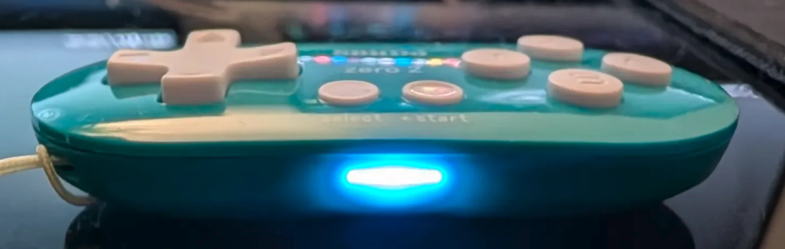
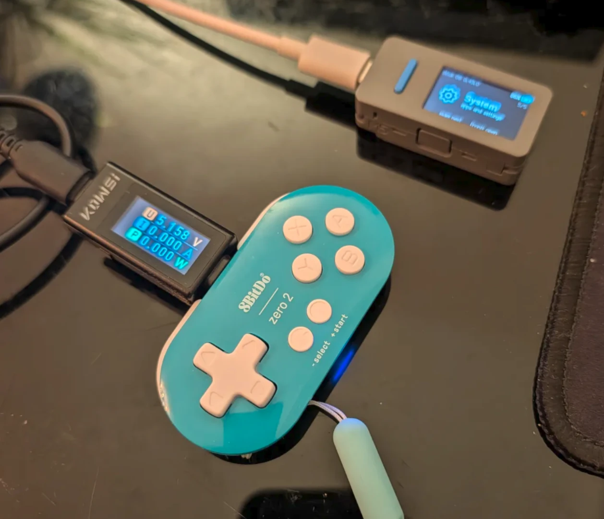

# 8BitDo Zero 2 BLE (custom firmware)

The 8Bitdo Zero 2 gamepad working over BLE and Bluetooth classic.






## Automatic patching

```
./build.sh
```

Downloads 8BitDo's firmware, decrypts it, applies the patch and leaves the file to flash in
`out/ble_hid/`. Needs a C compiler and `curl`, nothing else: the patch is in the repository as
bytes (`patches/ble_hid.txt`), and the ARM toolchain is only used to rebuild it from
`patches/ble_hid.s`, which this does by itself when one is installed.

```
./build.sh stock                      the official program again, to go back
./build.sh ble_hid zero2_v1.08.dat    a .dat you already have, instead of downloading one
```

## Building patched

Two ways, and they produce the same bytes.

**Patches.** `patches/*.txt` byte edits against the stock program, with the new code assembled
from the `.s` file beside them, `patches/ble_hid.txt` is the current build.
Each patch file chains from the one before it, so every tested build stays reproducible.

**C and a blob.** `src/` holds the known parts of the program as C, one file per original module,
recovered from the firmware by decompilation. Every other function keeps its C under
`#ifdef NONMATCHING`, to read, while its bytes come from `blob/blob.bin`. `link.ld` puts every
piece at its original address and checks that each compiled function still has its original size.

Ten of the module names in `src/` are the firmware's own: it carries assert strings naming
`yc_gpio.c`, `yc_adc.c`, `yc_exti.c`, `yc_sysctrl.c`, `yc_systick.c`, `yc_timer.c`,
`gamepad_hid.c`, `hw_config.c`, `btstack_app.c` and BTstack's run loop. The others are guesses.

```
make firmware
make patch
make check
```

`make firmware` fetches 8BitDo's own firmware from their update server and decrypts it. `make
patch` builds the image that goes on the pad. `make check` compiles the C, links it with the blob
from that image.

No firmware is kept in this repository, so the blob is cut from your own copy.

## Your own pad

Hold L + R + START to enter download mode (yellow/green light), then connect the USB:

```
sudo make probe
sudo make dump
make verify
```

`probe` searchs the pad (USB 2dc8:3208) and prints the answers. `dump` reads 0x14000 bytes from
0x01018000, the program and the flash this build adds after it, into `firmware/dumped/`.

`verify` compares that dump with the image this repository builds.

Building from a dump from a gamepad (no firmware download):

```
sudo make dump
make base-from-dump
make patch check
```

## Flashing

```
make patch
sudo make flash
```

It erases, writes and reads back the whole image before resetting.

## Analysis

`analysis/run_ghidra.sh` runs Ghidra headless over the decrypted program and writes the function
list, the strings, the byte layout and the decompiled C. `analysis/ghidra_scripts/` holds
the scripts for it. Needs Ghidra 12.2 and a JDK 21 or newer (`GHIDRA_HOME`, default `~/opt/ghidra_12.2_PUBLIC`).

## Structure

- `build.sh`: the automatic build above, from download to the file to flash.
- `patches/`: files and their assembly.
- `src/`, `include/`, `blob/`, `link.ld`, `Makefile`: the C build described above.
- `tools/zero2.c`: the firmware cipher, the patch builder and the boot mode flasher, in one
  program. `zero2 decrypt|encrypt|patch|probe|read|flash|wipe|reset|jump`.
- `tools/genble.c`: builds each mode's GATT table and rewritten SDP records, assembles the build's
  own code and writes its patch file.
- `tools/gen_blob.sh`: cuts `blob/blob.bin` out of an image.
- `tools/fetch_firmware.sh`, `tools/decrypt.sh`: the download and the decryption.

The YC3121 datasheets :
[HorrorTroll/Yichip_YC3121](https://github.com/HorrorTroll/Yichip_YC3121).
